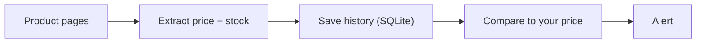

# Competitor Price Monitor

> Tracks competitor prices across stores, keeps the history, and alerts you when someone undercuts you.

     

**Sector:** E-commerce & Market Intelligence  ·  **Project 45 of 50** in my [AI Automation Projects series](https://github.com/Princewill106/Princewill106)

## The problem

Online sellers lose sales when a competitor quietly drops their price, and only find out when orders slow down. Checking ten competitor pages every morning by hand doesn't happen consistently.

## How it works



1. **Configure** — List products, competitor URLs and the element that holds the price in `watchlist.json`.
2. **Fetch** — Pages are fetched (respecting robots.txt and a polite delay in live mode) or read from `sample_pages/` in the demo.
3. **Extract** — A small HTML parser finds the element by tag, class or id and reads price and stock text.
4. **Store** — Each observation is saved to `prices.db` (SQLite) for history and trend checks.
5. **Alert** — Price drops above a threshold, and competitors undercutting your price, are flagged in the daily alert.

## Features

- Selector-based extraction with the standard library
- Currency and number normalisation
- SQLite price history
- Drop and undercut alerts
- Offline demo with saved pages
- Polite live mode (robots.txt check, delays, user-agent)

## Quick start

```bash
git clone https://github.com/Princewill106/price-monitor-scraper.git
cd price-monitor-scraper
python main.py --demo
```

No installs needed: it uses only the Python standard library. The demo runs fully offline using the sample data in this repo.

**Optional: plug in an LLM.** Copy `.env.example` to `.env` and add an Anthropic or OpenAI key. The project will then use the model for the language-heavy steps and fall back to its rule-based logic if a call fails.

Run the tests:

```bash
python -m unittest -v
```

## Sample output

```text
PowerPal 20K power bank    GadgetHub    NGN    25,900 in stock
PowerPal 20K power bank    TechMart     NGN    28,500 OUT OF STOCK

ALERTS:
  - GadgetHub dropped PowerPal 20K power bank from 29,500 to 25,900
  - GadgetHub undercuts you on PowerPal 20K power bank: 25,900 vs your 27,000
```

## Use it in n8n (no code needed)

[`n8n-workflow.json`](n8n-workflow.json) is a ready-to-import n8n version of this project, built for n8n 1.x.

1. In n8n, open **Workflows → Import from File** and choose `n8n-workflow.json`.
2. Click **Test workflow**. It runs the full logic on the sample data built into the *Sample data* node, so you can see the results before connecting anything.
3. Open each output node and connect your accounts: Slack. For Google Sheets, pick your spreadsheet and sheet.
4. Adjust the settings at the top of the **Logic** node (thresholds, templates, contacts), then **Activate**.

**Flow:** **Schedule (daily 8am)** → Watchlist → Fetch product page → **Logic** (Code node) → **Route** (Switch)

**Outputs:**
- Price alert (Slack)

The Logic node is a JavaScript port of the rules in `main.py`, so you can run the project in n8n without Python.

## Use it on your own data

Edit `watchlist.json` with your products and competitor URLs and run `python main.py --live` daily. Only monitor public pages, respect each site's terms and robots.txt, and keep request rates low.

## Project structure

```text
n8n-workflow.json            Importable n8n workflow
.env.example                 Optional API key settings
.gitignore                   Git ignore rules
LICENSE                      MIT license
README.md                    This file
llm.py                       Optional LLM helper (offline fallback)
main.py                      Entry point and core logic
requirements.txt             Dependencies (stdlib only)
sample_page_gadgethub.html   Sample input data for the demo
sample_page_techmart.html    Sample input data for the demo
test_main.py                 Unit tests
watchlist.json               Reference / config data
```

## Who this is for

- Online stores and marketplace sellers
- Retail buyers tracking supplier prices
- Analysts building price indices

## Ideas to extend it

- [ ] Headless browser for JavaScript-rendered pages
- [ ] Charts of price history
- [ ] WhatsApp/Telegram alerts
- [ ] Automatic repricing suggestions

## About

Built by **Ogbu Ugochukwu Princewill**, AI Automation Lead and robotics engineer. I teach people and businesses to build with AI, not just talk about it. [LinkedIn](https://www.linkedin.com/in/ugochukwu-ogbu-653a0816a)

If this helped you, give it a ⭐ and share what you built with it.

## License

MIT — see [LICENSE](LICENSE).
